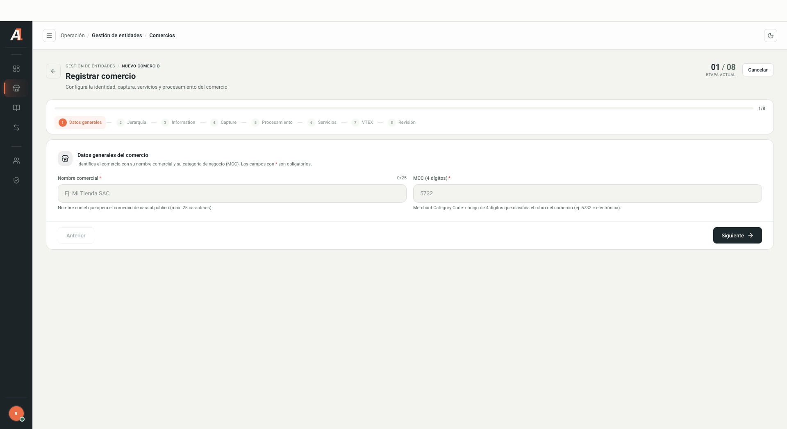
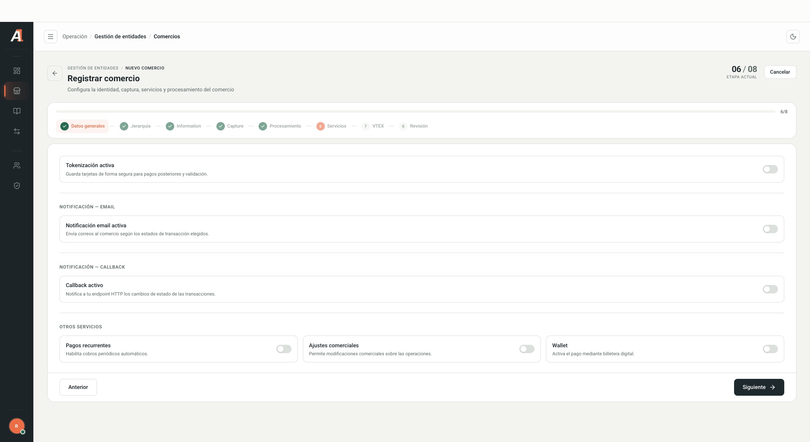

<a href="/command-center/introduccion">← Guía de Command Center</a>04 / COMERCIOS

## Consultar un comercio

1. Abre **Gestión de entidades → Comercios**.
2. Busca por nombre, nombre corto o Tax ID.
3. Selecciona **Todos**, **Activos** o **Inactivos**. Utiliza **Filtros**, **Tipo de captura**, **Procesadora** o **Engagement** cuando corresponda.
4. Pulsa **Buscar** y abre **Ver detalle** del registro correcto.

La tabla permite ajustar columnas y paginar. Verifica la entidad seleccionada antes de realizar una acción administrativa.

## Asistente de registro

Selecciona **Registrar comercio** para abrir el asistente. Los campos con asterisco son obligatorios.

<Frame caption="Formulario vacío de registro. Los valores grises son ejemplos del sistema.">
  
</Frame>

| Etapa | Qué revisar |
| --- | --- |
| Datos generales | Nombre comercial, con máximo de 25 caracteres, y MCC de cuatro dígitos. |
| Jerarquía | Adquirente y, si corresponde, Payment Facilitator. Las capacidades dependen de lo habilitado en la entidad padre. |
| Information | País, datos tributarios, razón social, ubicación, contacto, cuenta bancaria, moneda y URL del logo. |
| Capture | Configuración de captura y vista previa del checkout. Requiere seleccionar antes la jerarquía. |
| Procesamiento | Procesadoras, marcas y métodos permitidos por la entidad padre. La versión revisada indica procesamiento para Perú. |
| Servicios | Tokenización, notificación por email, callback, pagos recurrentes, ajustes comerciales y wallet, según lo acordado. |
| VTEX | Acceso para agregar una integración VTEX. |
| Revisión | Resumen previo a **Confirmar y crear comercio**. |

<Frame caption="Opciones visibles de servicios, sin activar ni modificar configuraciones.">
  
</Frame>

## Configurar Capture y Procesamiento

En **Capture**, activa **SDK** o **FLEX** según las opciones habilitadas por el adquirente o facilitador de pago. Solo se muestran los tipos de captura, métodos y marcas que esa entidad permite.

- **SDK:** al activarlo, permite configurar métodos, marcas y estilo.
- **FLEX:** al activarlo, permite configurar métodos, marcas e idiomas.
- Un tipo desactivado aparece como **Inactivo — no se enviará**.

La **Vista previa del checkout** es solo visual. Para mostrarla, la interfaz solicita activar SDK o FLEX y agregar métodos.

Antes de configurar métodos en **Procesamiento**, habilita al menos un método en **Capture**. Después utiliza **Agregar procesadora**; las procesadoras disponibles dependen del adquirente o facilitador seleccionado.

<Note>
El país seleccionado en **Information** actualiza los catálogos de documentos, geografía, bancos, tipos de cuenta y moneda. La interfaz revisada indica que el procesamiento se configura para **Perú**, independientemente del país elegido en Information. Seleccionar otro país o moneda en ese formulario no confirma disponibilidad de procesamiento para ellos.
</Note>

## Revisar antes de crear

En **Revisión**, comprueba nombre, MCC, país, razón social, Tax ID, moneda, captura, procesadoras y regiones de procesamiento. Usa **Anterior** para volver a las etapas previas y revisar los datos.

La captura recibida muestra campos vacíos en el resumen. Llegar a esta etapa no demuestra que el registro sea válido ni que se haya creado el comercio.

<Warning>
**Confirmar y crear comercio** registra la entidad; no es una vista previa. Valida la jerarquía, datos tributarios y bancarios, y configuración comercial con el responsable antes de confirmar.
</Warning>

<Note>
Esta guía describe las etapas observadas. No se ejecutó un alta ni se validaron los campos condicionales de captura, procesamiento o VTEX con una entidad de pruebas. Valida esos flujos antes de utilizarlos como un procedimiento de alta definitivo.
</Note>
