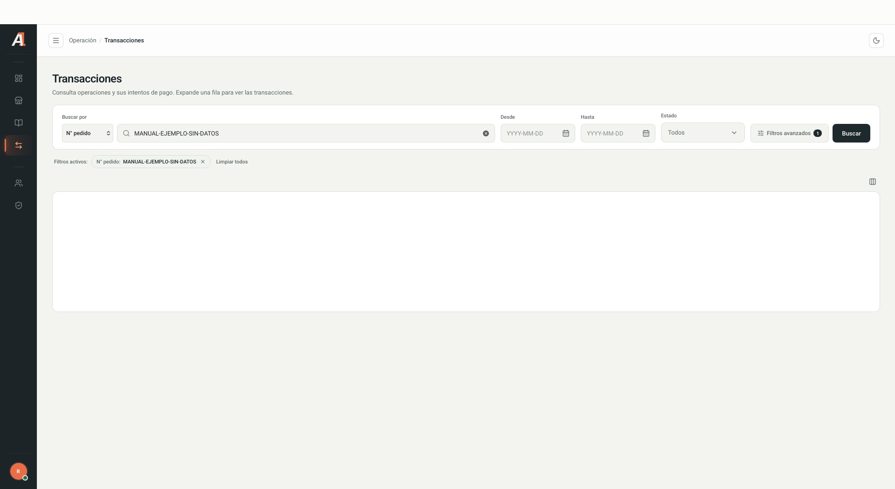

<a href="/command-center/introduccion">← Guía de Command Center</a>03 / TRANSACCIONES

Una **operación o pedido** puede tener varios **intentos de pago**. Consulta el intento específico antes de interpretar su resultado.

## Buscar una operación

1. Abre **Transacciones**.
2. En **Buscar por**, selecciona el identificador e ingresa el valor. La opción inicial observada fue **N° pedido**.
3. Completa **Desde**, **Hasta** y **Estado** si necesitas acotar la consulta.
4. Pulsa **Buscar**.
5. Revisa los filtros activos. Quita un criterio o selecciona **Limpiar todos** para ampliar la búsqueda.

<Frame caption="Búsqueda ficticia sin datos reales de clientes ni operaciones.">
  
</Frame>

## Filtros avanzados

Abre **Filtros avanzados**, completa los criterios disponibles y pulsa **Aplicar**. **Cancelar** cierra el panel y **Limpiar** restablece sus criterios.

| Grupo | Criterios habilitados observados |
| --- | --- |
| Organización | Adquirente y código de comercio. |
| Pago | Método, marca, procesadora, canal, BIN y últimos cuatro dígitos. |
| Operación | Terminal y observación. La observación requiere coincidencia exacta; el terminal puede faltar en operaciones antiguas. |
| Identificadores | N° de pedido, ID de operación e ID de transacción. |

<Note>Los campos deshabilitados o marcados como **Próximamente** no están disponibles para filtrar. Su disponibilidad puede cambiar según la versión.</Note>

## Leer los resultados

La tabla muestra Fecha, N° pedido, Comercio, Estado, Monto, Método, Marca, Canal e Intentos. Usa **Mostrar u ocultar columnas** para ajustar la vista y **Filas por página**, **Anterior** y **Siguiente** para recorrerla.

Si no aparecen resultados, verifica fechas, identificador, estado y filtros. Una lista vacía no demuestra que la operación no exista.

## Revisar intentos

### Desplegar la tabla de intentos

1. Selecciona **Expandir intentos**, la flecha al inicio de la fila de la operación.
2. Revisa la tabla que aparece debajo. Muestra número de intento, ID de transacción, método, marca, PAN enmascarado, moneda, monto, fechas, estado, observación, código de autorización y VCI/ECI, cuando están disponibles.
3. Selecciona **Colapsar intentos** para ocultar la tabla.

### Consultar el resumen de la operación

El panel de la operación es una vista distinta de la tabla desplegable. Presenta pedido, monto, estado, cantidad de intentos autorizados y fallidos, **Historial de intentos**, información del comercio e ID de operación. El control **Copiar ID de operación** permite copiar ese identificador.

<Note>
Las capturas muestran el panel abierto, pero no identifican el control utilizado para abrirlo desde el listado. Ese acceso queda pendiente de confirmar; **Expandir intentos** despliega la tabla y no debe describirse como la apertura de este panel.
</Note>

### Consultar el detalle de un intento

1. Desde **Historial de intentos**, selecciona el intento que deseas revisar.
2. Consulta sus pestañas según la información disponible.
3. Usa **Anterior** y **Siguiente** para recorrer los intentos de la misma operación.
4. Selecciona **Volver a operación** para regresar al resumen o cierra el panel con **✕**. **Copiar ID de transacción** copia el identificador del intento.

| Pestaña | Contenido observado |
| --- | --- |
| Pago | Información del pago, datos de tarjeta cuando existan y resultado con códigos de autorización y respuesta. |
| Cliente | Secciones Customer, Billing y Shipping. Los bloques sin datos muestran **Sin información**. |
| Trazabilidad | Ciclo de vida, cambios de estado, pasos de procesamiento, duración e inicio y fin. Algunos pasos ofrecen **Entrada** y **Salida** desplegables. |
| Técnico | Pestaña visible cuyo contenido está pendiente de documentar. |

Una operación autorizada puede conservar intentos anteriores denegados. Revisa el estado y la observación de cada intento para reconstruir lo ocurrido.

<Warning>
No compartas datos de clientes, tarjetas, identificadores ni contenidos de Entrada/Salida en documentos públicos. Un intento autorizado no confirma, por sí solo, la liquidación de la operación.
</Warning>
