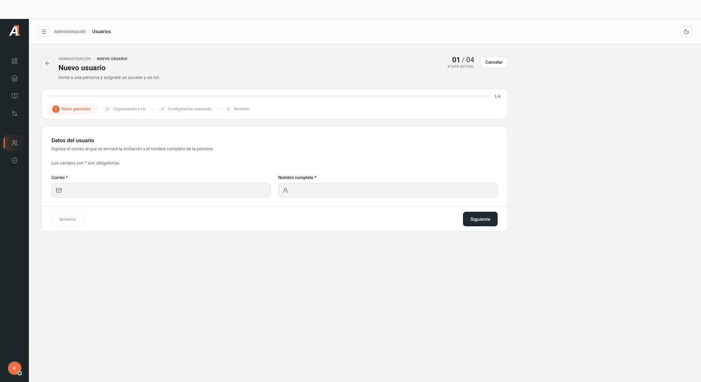
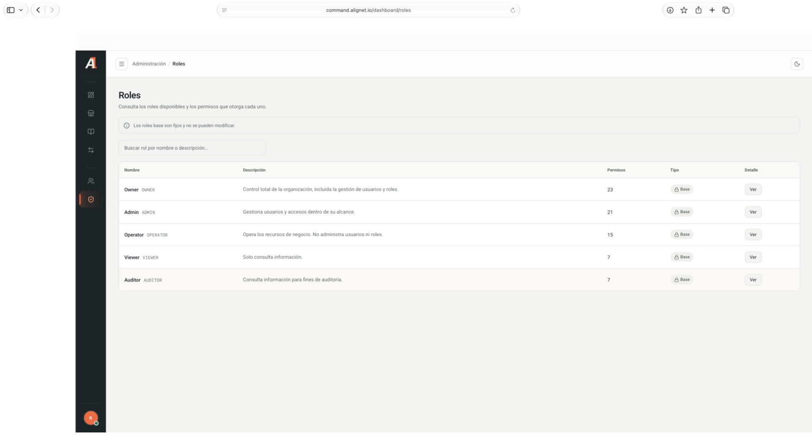

## Consultar usuarios

1. Abre **Usuarios**.
2. Busca por nombre o correo.
3. Filtra por estado, rol, tipo de organización, estado del acceso u organización. **Solo mi organización** limita la consulta.
4. Verifica organización, rol, estado y seguridad antes de gestionar un acceso.

## Preparar una invitación

Selecciona **Nuevo usuario**. La primera etapa solicita **Correo electrónico** y **Nombre completo**. El asistente muestra después Organización y rol, Configuración avanzada y Revisión.

<Frame caption="Formulario vacío, sin nombres ni correos reales.">
  
</Frame>

<Warning>Antes de enviar una invitación, confirma destinatario, organización y rol con el responsable. Asigna únicamente los permisos necesarios.</Warning>

<Note>
Solo se inspeccionó el formulario inicial y los nombres de las etapas. No se enviaron invitaciones ni se validaron las opciones internas de las etapas siguientes. El envío y la aceptación requieren validación en un ambiente de pruebas.
</Note>

## Consultar un rol

1. Abre **Roles** y busca por nombre o descripción.
2. Selecciona **Ver**.
3. Consulta los permisos agrupados por recurso. Puedes buscar un permiso y contraer los grupos.

| Rol | Descripción mostrada |
| --- | --- |
| Owner | Control total de la organización, incluida la gestión de usuarios y roles. |
| Admin | Gestiona usuarios y accesos dentro de su alcance. |
| Operator | Opera recursos de negocio; no administra usuarios ni roles. |
| Viewer | Consulta información. |
| Auditor | Consulta información para auditoría. |

<Frame caption="Roles base del sistema, sin información de personas.">
  
</Frame>

La pantalla indica que los roles base son fijos y no se pueden modificar. Consulta siempre el detalle vigente de permisos antes de asignar uno.
