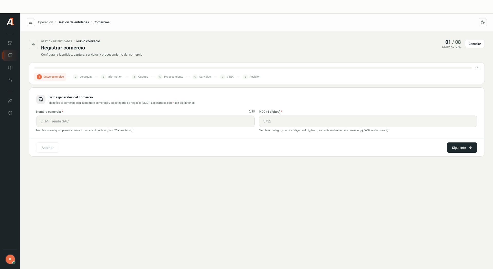
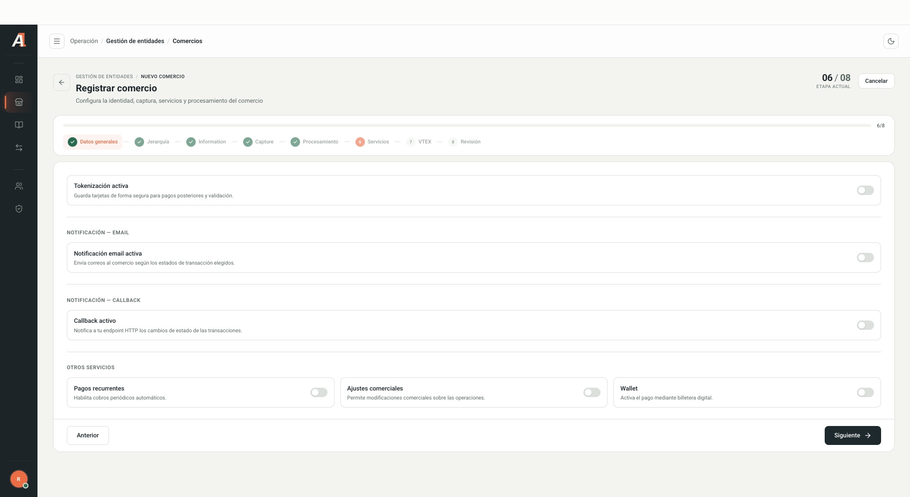

<a href="/en/command-center/introduction">← Command Center guide</a>04 / MERCHANTS

## Find a merchant

1. Open **Gestión de entidades → Comercios**.
2. Search by name, short name or Tax ID.
3. Select **Todos**, **Activos** or **Inactivos**. Use **Filtros**, **Tipo de captura**, **Procesadora** or **Engagement** as needed.
4. Select **Buscar**, then **Ver detalle** on the correct record.

You can adjust table columns and pagination. Check the selected entity before taking an administrative action. Control names match the original interface.

## Registration wizard

Select **Registrar comercio** to open the wizard. Fields marked with an asterisk are required.

<Frame caption="Empty registration form. Gray values are system examples. Interface shown in Spanish.">
  
</Frame>

| Stage in the interface | What to check |
| --- | --- |
| Datos generales | Merchant name, up to 25 characters, and four-digit MCC. |
| Jerarquía | Acquirer and, when applicable, Payment Facilitator. Capabilities depend on those enabled for the parent entity. |
| Information | Country, tax details, legal name, location, contact, bank account, currency and logo URL. |
| Capture | Capture settings and checkout preview. Select the hierarchy first. |
| Procesamiento | Processors, brands and methods permitted by the parent entity. The reviewed version indicates processing for Peru. |
| Servicios | Tokenization, email notification, callback, recurring payments, commercial adjustments and wallet, as agreed. |
| VTEX | Entry point to add a VTEX integration. |
| Revisión | Summary before **Confirmar y crear comercio**. |

<Frame caption="Visible service options, without activating or modifying settings.">
  
</Frame>

<Warning>
**Confirmar y crear comercio** registers the entity; it is not a preview. Confirm the hierarchy, tax and bank details, and commercial settings with the responsible person before submitting.
</Warning>

<Note>
This guide describes the observed stages. No merchant was created, and conditional capture, processing or VTEX fields were not validated using a test entity. Validate these flows before treating this as a definitive registration procedure.
</Note>
