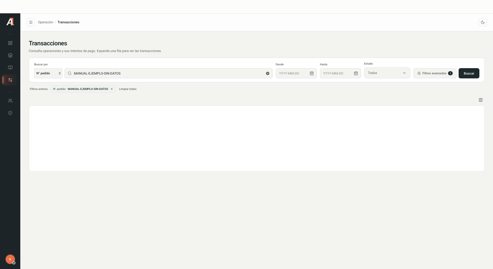

<a href="/en/command-center/introduction">← Command Center guide</a>03 / TRANSACTIONS

An **operation or order** can have several **payment attempts**. Review the specific attempt before interpreting its result. Control names below match the Spanish interface.

## Find an operation

1. Open **Transacciones**.
2. In **Buscar por**, choose an identifier and enter its value. The initial option observed was **N° pedido** (order number).
3. Complete **Desde**, **Hasta** and **Estado** to narrow the date range and status.
4. Select **Buscar**.
5. Review active filters. Remove a criterion or select **Limpiar todos** to broaden the search.

<Frame caption="Fictional search with no real customer or transaction data. Interface shown in Spanish.">
  
</Frame>

## Advanced filters

Open **Filtros avanzados**, complete the available criteria and select **Aplicar**. **Cancelar** closes the panel and **Limpiar** resets its criteria.

| Group | Enabled criteria observed |
| --- | --- |
| Organization | Acquirer and merchant code. |
| Payment | Method, brand, processor, channel, BIN and last four digits. |
| Operation | Terminal and observation. The observation requires an exact match; older operations may not include a terminal. |
| Identifiers | Order number, operation ID and transaction ID. |

<Note>Disabled fields or fields marked **Próximamente** are not available for filtering. Availability may change by version.</Note>

## Read the results

The table shows date, order number, merchant, status, amount, method, brand, channel and attempts. Use **Mostrar u ocultar columnas** to adjust columns and **Filas por página**, **Anterior** and **Siguiente** to navigate results.

If no results appear, check dates, identifier, status and filters. An empty list does not prove the operation does not exist.

## Review attempts

1. Select **Expandir intentos** on the operation.
2. Review the status, amount and authorized and failed attempt summary.
3. Open the relevant attempt in **Historial de intentos**.
4. Explore **Pago**, **Cliente**, **Trazabilidad** and **Técnico**, according to your permissions.
5. Select **Volver a operación** to return to the summary.

**Pago** contains payment information, card data when available, and authorization and response codes. **Trazabilidad** shows state changes, processing steps, duration, start and end times; some steps include **Entrada** and **Salida** (input and output).

<Warning>
Do not share customer data, card data, identifiers or input/output payloads in public documents. An authorized attempt alone does not confirm settlement.
</Warning>
