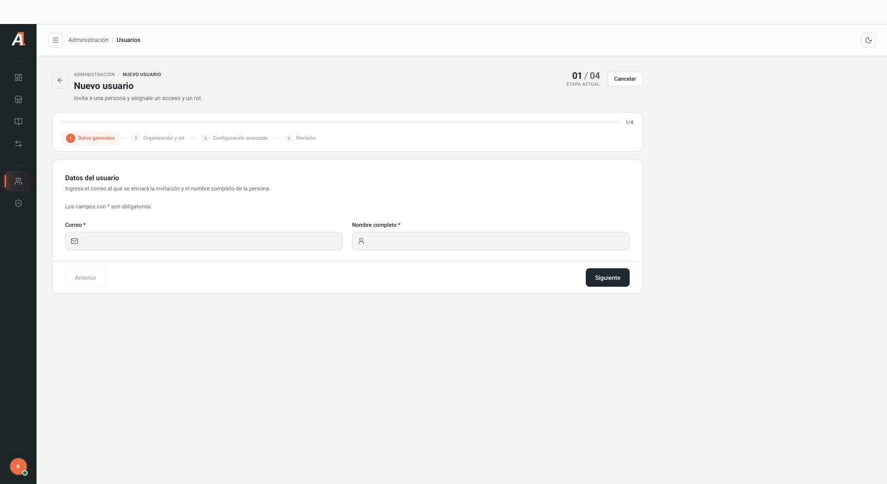
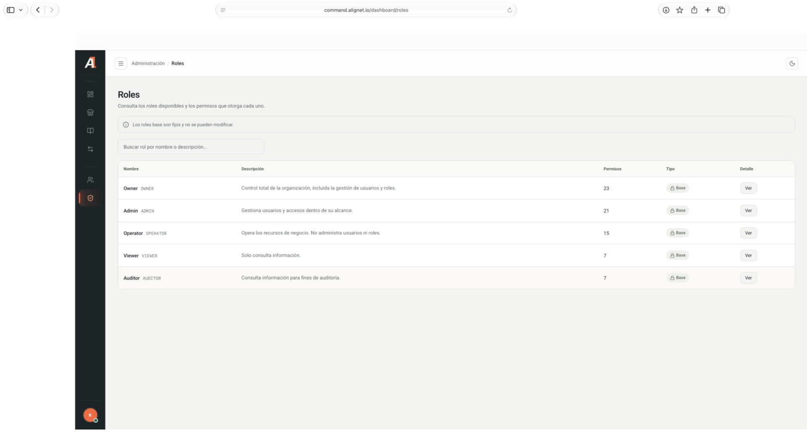

<a href="/en/command-center/introduction">← Command Center guide</a>07 / USERS AND ROLES

## Find users

1. Open **Usuarios**.
2. Search by name or email.
3. Filter by status, role, organization type, access status or organization. **Solo mi organización** limits the query to your organization.
4. Check organization, role, status and security before managing access.

Control names below match the Spanish interface.

## Prepare an invitation

Select **Nuevo usuario**. The first stage asks for **Correo electrónico** (email) and **Nombre completo** (full name). The wizard then shows organization and role, advanced settings and review.

<Frame caption="Empty form with no real names or emails. Interface shown in Spanish.">
  
</Frame>

<Warning>Before sending an invitation, confirm the recipient, organization and role with the responsible person. Assign only the permissions needed.</Warning>

<Note>
Only the initial form and stage names were inspected. No invitations were sent, and options within later stages were not validated. Sending and accepting invitations require testing in a test environment.
</Note>

## Review a role

1. Open **Roles** and search by name or description.
2. Select **Ver**.
3. Review permissions grouped by resource. You can search for a permission and collapse groups.

| Role | Description shown |
| --- | --- |
| Owner | Full control of the organization, including user and role management. |
| Admin | Manages users and access within their scope. |
| Operator | Operates business resources; does not manage users or roles. |
| Viewer | Views information. |
| Auditor | Views information for audit purposes. |

<Frame caption="System base roles, with no personal information.">
  
</Frame>

The screen indicates that base roles are fixed and cannot be modified. Always check current permissions before assigning a role.
